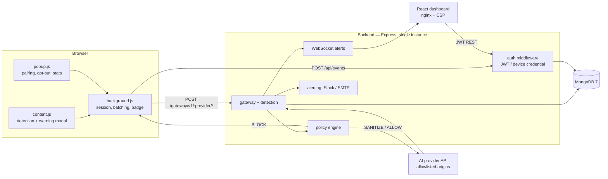
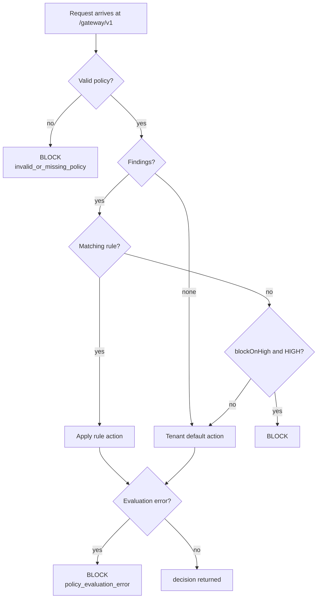

# Shadow AI Auditor — Project Documentation

> Consolidated technical documentation for the Shadow AI Auditor proof of concept.
> This document is derived from the source tree at the time of writing. Where a
> statement could not be verified by reading source or running the test suites,
> it is explicitly labelled **Unverified** or **Not implemented**.

**Contents**

1. [Overview](#1-overview)
2. [Problem and Solution](#2-problem-and-solution)
3. [Feature Set](#3-feature-set)
4. [Architecture](#4-architecture)
5. [Technology Stack](#5-technology-stack)
6. [Installation and Setup](#6-installation-and-setup)
7. [Environment Variables](#7-environment-variables)
8. [Data Flow and Workflows](#8-data-flow-and-workflows)
9. [API Reference](#9-api-reference)
10. [Database Schema and Models](#10-database-schema-and-models)
11. [Key Modules](#11-key-modules)
12. [Authentication and Security](#12-authentication-and-security)
13. [Testing and Verified Coverage](#13-testing-and-verified-coverage)
14. [Build, Deployment and Maintenance](#14-build-deployment-and-maintenance)
15. [Known Limitations and Future Work](#15-known-limitations-and-future-work)
16. [Troubleshooting and FAQ](#16-troubleshooting-and-faq)
17. [Directory Structure](#17-directory-structure)

---

## 1. Overview

Shadow AI Auditor is a tenant-scoped data-loss-prevention (DLP) system for
sensitive data that employees send to public AI tools. It has three parts:

| Component | Path | Role |
|---|---|---|
| Browser extension | `shadow-extension/` | Detects sensitive content in AI chat inputs in the browser and routes prompts through the enforcement gateway |
| Backend API | `backend/` | Authenticates, detects, evaluates policy, enforces decisions, proxies to AI providers, stores events, sends alerts |
| Dashboard | `frontend/` | React console for overview, events, users, analytics, justifications, audit log, and settings |

Two independent request paths exist by design:

```
report-only path   extension ──► POST /api/events      ──► Event + AuditLog
enforcing path     extension ──► POST /gateway/v1/...  ──► ALLOW | WARN | SANITIZE | BLOCK
```

The gateway (`backend/src/routes/gateway.js`) is the enforcement boundary. The
report-only path (`backend/src/routes/events.js`) never blocks anything; it
exists so that opted-out users and non-proxied sites still produce a complete
audit trail.

**Project status:** proof of concept. It is not an enterprise product. Known
limitations are listed in [§15](#15-known-limitations-and-future-work).

---

## 2. Problem and Solution

### Problem

Employees paste credentials, customer PII, and confidential source code into
public AI chat tools. The traffic is outbound HTTPS to a third-party domain, so
traditional network DLP cannot inspect it, and the browser is the only place
where the plaintext intent is visible.

### Solution

1. **Detect** sensitive content locally in the browser before it is sent.
2. **Record** every finding as a tenant-scoped `Event` with risk score,
   severity, and policy decision.
3. **Enforce** policy server-side at the gateway: `BLOCK` never contacts the AI
   provider, `SANITIZE` redacts detected secrets before forwarding, and every
   decision is audited.

### Design principles

- **Server-authoritative policy.** The extension proposes; the server decides.
  Client-supplied severity, risk score, decision, `orgId`, and `userId` are
  ignored (`backend/src/routes/gateway.js`).
- **Fail closed.** A missing or invalid policy yields `BLOCK`
  (`backend/src/services/policy-engine.js`).
- **Evidence over assertion.** Security-relevant behaviour is covered by the
  backend test suites (see [§13](#13-testing-and-verified-coverage)).
- **Secrets are environment-only.** No secret is read from source.

---

## 3. Feature Set

### Detection

- Local detection engine in the extension runs on paste, typing, modal-cancel,
  and modal-proceed events (`shadow-extension/src/content.js`).
- Pattern set (`shadow-extension/src/detectionEngine.js` and the server copy in
  `backend/src/routes/gateway.js`) covers AWS access/secret keys, Stripe
  secret/publishable keys, GitHub personal/OAuth tokens, NPM tokens, JWT, RSA/EC/
  OpenSSH private keys, generic secrets/passwords, database connection strings,
  email, US SSN, credit-card numbers, US phone numbers, and internal IP
  addresses, plus confidentiality keywords (e.g. *confidential*, *internal only*,
  *do not share*, *proprietary*, *trade secret*, *NDA*, *attorney-client*,
  *classified*).
- Server re-analyses reported previews and scores them, so stored severity does
  not depend on the client.

### Enforcement

Policy decisions are `ALLOW`, `WARN`, `SANITIZE`, `BLOCK`:

| Decision | Behaviour |
|---|---|
| `BLOCK` | HTTP 403. Event stored with `enforcementStatus=PREVENTED`, `requestForwarded=false`. The AI provider is never called. |
| `SANITIZE` | Detected secrets are replaced with `[REDACTED:…]` before forwarding. If the payload cannot be re-parsed, the request fails closed (500, no send). |
| `ALLOW` / `WARN` | Forwarded with a request-header allowlist and an upstream timeout; redirects are not followed. |

### Auditing and reporting

- Every finding and gateway decision is written as an `Event` plus an
  `AuditLog` entry.
- Dashboard pages (`frontend/src/pages/`): Overview, Events, Users, Analytics,
  and Settings are routed; Justifications and AuditLog exist but are not
  currently wired into the router (see the note in [§9.13](#913-operational-endpoints)).
- Real-time alerts: WebSocket broadcast of HIGH/CRITICAL events to open
  dashboard tabs, plus optional Slack webhook and SMTP email.
- Tenant onboarding: platform administrator creates tenants and issues
  single-use invitations. There is **no self-service signup**.

### Extension UX

- In-page warning modal before submitting sensitive content.
- Popup with device pairing, opt-out toggle, and session statistics
  (`shadow-extension/src/popup.js`, `src/popup.html`).
- Toolbar badge reflects recent detection activity.

---

## 4. Architecture

### 4.1 Component topology



### 4.2 Trust boundaries

| # | Boundary | Crossing | Control |
|---|---|---|---|
| 1 | Page → content script | DOM text | Local detection only; raw text is never logged or uploaded |
| 2 | Extension → API | HTTP | Device credential (`dvc_…`) or user JWT; CORS allowlist; packaged extension origin `chrome-extension://[a-p]{32}` accepted |
| 3 | Client → gateway | Prompt body | Server-side detection, policy decision, optional sanitisation |
| 4 | Backend → AI provider | Upstream request | Fixed origins, path validation, request header allowlist, timeout, no redirects |
| 5 | AI provider → client | Upstream response | Response header allowlist, response inspection, finding-count header |
| 6 | Dashboard → API | Credentialed REST | JWT, role checks, tenant scoping on every query |
| 7 | Backend → Slack/SMTP | Outbound webhook | `https:` only; private/loopback/metadata hosts rejected (`backend/src/utils/url-guard.js`) |
| 8 | Anonymous → API | Rate limits | Per-route limiters for auth, events, policies, platform admin, gateway |

Anything not explicitly allowed at a boundary is dropped.

### 4.3 Identity model

| Credential | Issued to | Scope | Notes |
|---|---|---|---|
| User JWT (`tokenType: user`) | dashboard user | org + user + `authVersion` | 7-day TTL, HS256; revoked by bumping `authVersion` |
| Device credential (`dvc_…`) | extension after pairing | device + owner user | stored as a hash; revocable per device |
| Platform admin JWT (`tokenType: platform_admin`) | operator | platform | 15-minute access token, separate collection |
| WebSocket ticket | dashboard session | one user, one org | single use, 20-second TTL |

Roles inside a tenant: `admin`, `manager`, `viewer`. Platform administration is a
separate plane (`/api/platform-admin/*`) with its own roles `super_admin` and
`manager`.

### 4.4 Schema versioning and migration strategy

Source: `ARCHITECTURE.md` §5.1 and `backend/src/server.js`.

- Additive, backward-compatible schema evolution (expand → migrate/dual-write →
  contract); no heavyweight migration framework.
- Version-bearing fields: `Org.policyVersion`, `Policy.version`,
  `Event.policyVersion`.
- `autoIndex: false`; declarative indexes (including TTL indexes and sparse
  compound unique indexes) are synced at startup via `Model.createIndexes()`,
  with legacy index names dropped defensively.
- `/ready` gates traffic until MongoDB is connected and indexes are synced.

---

## 5. Technology Stack

| Layer | Technology | Version (from manifest) |
|---|---|---|
| Backend runtime | Node.js (ESM) | Node 20+ (`PROJECT_OVERVIEW.md`); exact engine **Unverified** |
| Backend framework | Express | `^4.18.2` |
| Database | MongoDB + Mongoose | MongoDB 7 / Mongoose `^8.0.3` |
| Auth | jsonwebtoken, bcryptjs | `^9.0.2`, `^2.4.3` |
| Validation | zod | `^3.22.4` |
| Logging | winston, morgan | `^3.11.0`, `^1.10.0` |
| Alerts | nodemailer, Slack webhook | `^6.9.7` |
| Scheduling | node-cron | `^3.0.3` |
| Real-time | ws | `^8.20.0` |
| Backend tests | jest, supertest | `^29.7.0`, `^7.3.1` |
| Frontend | React + Vite + Tailwind | React `^18.2.0`, Vite `^5.0.11`, Tailwind `^3.4.1` |
| Frontend routing | react-router-dom | `^6.21.0` |
| Frontend state | zustand | `^4.4.7` |
| Charts | recharts | `^2.10.3` |
| 3D / animation | three, @react-three/fiber, @react-three/drei, gsap | `^0.184.0`, `^8.18.0`, `^9.122.0`, `^3.15.0` |
| Extension | Chrome MV3, Vite | manifest v3, Vite `^8.0.4`, React `^19.2.4` |
| Packaging | Docker Compose, nginx (envsubst) | — |

Exact version sources: `backend/package.json`, `frontend/package.json`,
`shadow-extension/package.json`, `shadow-extension/public/manifest.json`.

---

## 6. Installation and Setup

### 6.1 Prerequisites

- Node.js 20+ and npm
- Docker (for MongoDB locally) or an existing MongoDB 7 instance
- A Chromium-based browser for the extension

### 6.2 Local development

```bash
git clone https://github.com/sudha16-sketc/Shadow_AI.git
cd Shadow_AI

# Environment (git-ignored; examples are committed with placeholders only)
cp .env.example .env
cp backend/.env.example backend/.env
node -e "console.log(require('crypto').randomBytes(48).toString('base64url'))"  # paste into backend/.env JWT_SECRET

# Database
docker run -d -p 27017:27017 --name mongo docker.io/library/mongo:7

# API  →  http://localhost:3001
cd backend  && npm install && npm run dev

# Dashboard  →  http://localhost:5173
cd ../frontend && npm install && npm run dev
```

### 6.3 Extension build

```bash
cd shadow-extension && npm ci && npm run build:development
# chrome://extensions → Developer mode → Load unpacked → shadow-extension/dist
```

There is **no self-service signup**: an operator provisions a platform
administrator, who creates a tenant and issues a single-use invitation. See
[§8.4](#84-tenant-and-user-onboarding).

### 6.4 Full stack via Docker Compose

```bash
cp .env.example .env          # set JWT_SECRET, VITE_API_URL, CORS_ORIGINS
docker compose up -d --build  # mongo :27017, API :3001, dashboard :5173
curl -s localhost:3001/health # {"status":"ok", …}
curl -s localhost:3001/ready  # {"status":"ready"}
```

Compose services (`docker-compose.yml`): `mongo`, `backend`, `frontend`.

---

## 7. Environment Variables

All runtime configuration is environment-only. `.env` files are git-ignored;
`.env.example` files are committed with placeholders and must never contain real
values.

### 7.1 Backend (`backend/.env`, template `backend/.env.example`)

| Variable | Purpose | Default / example |
|---|---|---|
| `NODE_ENV` | Runtime mode | `development` |
| `PORT` | API port | `3001` |
| `JWT_SECRET` | **Required.** HS256 signing secret; 48+ bytes, 16+ distinct chars | *(empty; set in `.env`)* |
| `MONGODB_URI` | Mongo connection string | `mongodb://localhost:27017/shadow-ai-auditor` |
| `CORS_ORIGINS` | Comma-separated allowed credentialed origins | `http://localhost:5173,http://127.0.0.1:5173,http://localhost:4173` |
| `TRUST_PROXY` | Trust `X-Forwarded-For` behind a proxy | `false` |
| `GATEWAY_TIMEOUT_MS` | Upstream AI provider timeout (ms) | `60000` |
| `SHUTDOWN_GRACE_MS` | In-flight drain time on SIGTERM/SIGINT | `15000` |
| `AUDIT_EXPORT_MAX_ROWS` | Cap on `GET /api/audit-log/export` rows | `10000` |
| `LOG_LEVEL` | `trace\|debug\|info\|warn\|error` | `info` |
| `FRONTEND_URL` | Origin used in alert links | `http://localhost:5173` |
| `SMTP_HOST`/`SMTP_PORT`/`SMTP_USER`/`SMTP_PASS`/`SMTP_FROM` | Optional email alerting (blank disables) | `587`, `shadow-ai@example.com` |
| `PLATFORM_ADMIN_EMAIL` / `PLATFORM_ADMIN_PASSWORD` | One-time bootstrap for `npm run provision:platform-admin` | *(empty)* |

Validation: `backend/src/config/security.js` rejects a `JWT_SECRET` shorter than
48 bytes or with fewer than 16 distinct characters at startup.

### 7.2 Host / Compose (`.env`, template `.env.example`)

| Variable | Purpose |
|---|---|
| `JWT_SECRET` | Required; passed to the backend container |
| `MONGODB_URI` | Backend container Mongo connection (`mongodb://mongo:27017/shadow-ai-auditor`) |
| `VITE_API_URL` | Browser-visible backend origin; used for CORS and CSP `connect-src` |
| `CORS_ORIGINS` | Credentialed origins |
| `PLATFORM_ADMIN_EMAIL` / `PLATFORM_ADMIN_PASSWORD` | Bootstrap (must be provided at run time) |
| `SMTP_*` | Optional alerting |
| `FRONTEND_URL` | Dashboard origin for the extension popup link |

### 7.3 Frontend (`frontend/.env`)

| Variable | Purpose |
|---|---|
| `VITE_API_URL` | API base URL baked in at build time |
| `VITE_WS_URL` | WebSocket base URL |

### 7.4 Extension (`shadow-extension/.env.<mode>.example`)

| Variable | Development | Staging | Production |
|---|---|---|---|
| `VITE_API_URL` | `http://localhost:3001` | `https://staging-api.example.invalid` | `https://api.example.invalid` |
| `VITE_DASHBOARD_URL` | `http://localhost:5173` | `https://staging-dashboard.example.invalid` | `https://dashboard.example.invalid` |

`shadow-extension/vite.config.js` refuses to build staging/production against a
localhost or non-HTTPS `VITE_API_URL`, and rewrites the packaged manifest so
`host_permissions` contains only the configured API origin plus the supported AI
sites.

---

## 8. Data Flow and Workflows

### 8.1 Report-only telemetry

```
content.js detects findings
  → background.js queues and batches (alarm flush every 1 min)
  → POST /api/events  (device credential)
  → server re-analyses the reported preview, scores it, stores Event
  → AuditLog entry, alert on HIGH/CRITICAL, WebSocket broadcast
```

`policyDecision` on these events records what *would* happen; it never blocks.

### 8.2 Enforcing gateway

```
extension → POST /gateway/v1/openai/v1/chat/completions
  1. authMiddleware       → req.user (tenant, user, device)
  2. provider allowlist   → openai | anthropic, safe path, JSON body
  3. org lookup           → must exist and lifecycleStatus=active
  4. server detection     → analyzeText(prompt) → findingLabels
  5. evaluatePolicy       → decision, riskScore, severity, policyVersion
  6. decision:
       BLOCK     → 403, Event(enforcementStatus=PREVENTED), upstream never called
       SANITIZE  → redact pattern matches, Event(SANITIZED, sanitizedRedactions)
       ALLOW/WARN→ forward
  7. upstream call        → allowlisted headers, timeout, redirect=error
  8. response inspection  → detect findings in provider output, audit, header
  9. Event + AuditLog written, response relayed
```

### 8.3 Enforcement decision flow



### 8.4 Tenant and user onboarding

There is no self-service signup. `POST /api/auth/signup` is intentionally
disabled (403).

```
operator   → npm run provision:platform-admin   (PLATFORM_ADMIN_EMAIL/PASSWORD)
platform   → POST /api/platform-admin/auth/login
           → POST /api/platform-admin/tenants                    → tenant + invitation (24h, single use)
           → POST /api/platform-admin/tenants/:id/invitations    → re-issue/replace invite
invitee    → POST /api/platform-admin/invitations/accept         → tenant active + first admin
admin      → dashboard: create users, pair devices, set policy
user       → POST /api/auth/login → POST /api/auth/device/enrollment-code
extension  → POST /api/auth/device/register  (one-time pairing code)
```

### 8.5 Real-time alerts

```
dashboard → POST /api/auth/ws-ticket (JWT, admin/manager)
          → { ticket, expiresAt }     single use, 20s TTL, tenant bound
ws://…/api/alerts?ticket=…            consumed once, then deleted
          → tenant-scoped broadcast of HIGH/CRITICAL events
```

Tickets live in process memory: single-instance only.

---

## 9. API Reference

**Base path:** `/api` for management routes, `/gateway/v1` for enforcement.
**Auth:** unless noted, routes require a bearer JWT (`Authorization: Bearer …`).

### 9.1 Auth — `backend/src/routes/auth.js` → `/api/auth`

| Method | Path | Auth | Purpose |
|---|---|---|---|
| POST | `/login` | none | Tenant user login; returns JWT + user |
| POST | `/signup` | none | Disabled — returns 403 |
| GET | `/check-auth` | user JWT | Validate session, return current user |
| POST | `/logout` | user JWT | Bump `authVersion` to revoke tokens |
| POST | `/device/enrollment-code` | user JWT | Issue one-time device pairing code |
| POST | `/device/register` | enrollment code | Register extension device → `dvc_` credential |
| POST | `/device/:deviceId/revoke` | user JWT | Revoke a device |
| POST | `/ws-ticket` | user JWT (`admin`/`manager`) | Issue single-use WebSocket ticket |

### 9.2 Events — `backend/src/routes/events.js` → `/api/events`

| Method | Path | Auth | Purpose |
|---|---|---|---|
| POST | `/` | device (`dvc_`) | Report a detection event |
| POST | `/batch` | device | Report a batch of events |
| GET | `/` | user | List events (paginated, tenant-scoped) |
| GET | `/stats` | user | Aggregate event statistics |

### 9.3 Users — `backend/src/routes/users.js` → `/api/users`

| Method | Path | Role | Purpose |
|---|---|---|---|
| GET | `/` | admin, manager | List users |
| GET | `/departments` | admin, manager | List department names |
| GET | `/:id` | admin, manager | Get a user |
| POST | `/` | admin | Create a user |
| PATCH | `/:id` | admin | Update a user |
| PATCH | `/:id/password` | admin | Reset a user's password |
| PATCH | `/:id/opt-out` | self or admin | Toggle opt-out |
| DELETE | `/:id` | admin | Deactivate a user |
| GET | `/:id/events` | admin, manager | List a user's events |

### 9.4 Analytics — `backend/src/routes/analytics.js` → `/api/analytics`

| Method | Path | Purpose |
|---|---|---|
| GET | `/overview` | Security score and headline metrics |
| GET | `/risk-timeline` | Risk over time |
| GET | `/top-users` | Highest-risk users |
| GET | `/severity-breakdown` | Counts by severity |

### 9.5 Settings — `backend/src/routes/settings.js` → `/api/settings`

| Method | Path | Role | Purpose |
|---|---|---|---|
| GET | `/org` | admin | Read org settings |
| PATCH | `/org` | admin | Update org settings |
| PATCH | `/org/policy` | admin | Update default policy |
| POST | `/slack/test` | admin | Send a test Slack alert |
| POST | `/email/test` | admin | Send a test email alert |
| GET | `/domains` | admin | List monitored domains |
| PATCH | `/domains` | admin | Update monitored domains |

### 9.6 Justifications — `backend/src/routes/justifications.js` → `/api/justifications`

| Method | Path | Role | Purpose |
|---|---|---|---|
| POST | `/` | user | Submit a justification for a warning |
| GET | `/pending` | admin, manager | List pending justifications |
| GET | `/` | admin, manager | List justifications |
| GET | `/:id` | admin, manager | Get a justification |
| PATCH | `/:id/approve` | admin, manager | Approve a justification |

### 9.7 Audit log — `backend/src/routes/audit-log.js` → `/api/audit-log`

| Method | Path | Role | Purpose |
|---|---|---|---|
| GET | `/` | admin, manager | List audit entries (paginated) |
| GET | `/export` | admin | Export audit log (CSV; capped by `AUDIT_EXPORT_MAX_ROWS`) |
| GET | `/:id` | admin, manager | Get an audit entry |

### 9.8 Policies — `backend/src/routes/policies.js` → `/api/policies`

| Method | Path | Role | Purpose |
|---|---|---|---|
| GET | `/` | user | List policies |
| GET | `/:id` | user | Get a policy |
| POST | `/` | org admin | Create a policy |
| PUT | `/:id` | org admin | Update a policy |
| DELETE | `/:id` | org admin | Delete a policy |

### 9.9 Gateway — `backend/src/routes/gateway.js` → `/gateway/v1`

| Method | Path | Auth | Purpose |
|---|---|---|---|
| POST | `/:provider/*` | device/user | Detect, evaluate policy, optionally sanitise, then proxy to the AI provider |

Supported providers: `openai` (`https://api.openai.com`) and `anthropic`
(`https://api.anthropic.com`), defined in the `PROVIDERS` map in
`backend/src/routes/gateway.js`; any other provider returns HTTP 400. The global
prefix `/gateway/v1` is mounted with `authMiddleware` in `backend/src/app.js`.

### 9.10 Platform admin — `backend/src/routes/platform-admin.js` → `/api/platform-admin`

| Method | Path | Auth | Purpose |
|---|---|---|---|
| POST | `/auth/login` | none | Platform admin login (15-min token) |
| POST | `/invitations/accept` | invitation token | Activate tenant + create first admin |
| GET | `/tenants` | platform admin | List tenants |
| POST | `/tenants` | `super_admin` | Create a tenant + invitation |
| POST | `/tenants/:tenantId/invitations` | `super_admin` | Re-issue/replace an invitation |
| PATCH | `/tenants/:tenantId/status` | `super_admin` | Activate/suspend a tenant |

### 9.11 Platform monitoring — `backend/src/routes/platform-monitoring.js` → `/api/platform-admin/monitoring`

| Method | Path | Purpose |
|---|---|---|
| GET | `/overview` | Platform-wide metrics |
| GET | `/events` | Cross-tenant event feed |
| GET | `/events/:id` | Event detail |
| PATCH | `/events/:id/investigation` | Update investigation subdoc |
| GET | `/tenants` | Tenant health list |
| GET | `/audit` | Platform audit log |
| GET | `/auth-events` | Authentication event feed (TTL 30d) |
| GET | `/health` | Monitoring health |

### 9.12 Platform managers — `backend/src/routes/platform-managers.js` → `/api/platform-admin/managers`

All routes are `super_admin` only (enforced by `requirePlatformRole`).

| Method | Path | Purpose |
|---|---|---|
| GET | `/` | List platform managers |
| POST | `/` | Create a platform manager (bcrypt cost 12) |
| PATCH | `/:managerId` | Update a platform manager |
| PATCH | `/:managerId/password` | Reset a platform manager password |
| DELETE | `/:managerId` | Delete a platform manager |

### 9.13 Operational endpoints

| Method | Path | Purpose |
|---|---|---|
| GET | `/health` | Liveness; `{"status":"ok", …}` |
| GET | `/ready` | Readiness; `{"status":"ready"}` once Mongo is connected |

**Route count:** 65 route handlers across `backend/src/routes/` (verified by
inspection of router definitions).

> **Frontend routing note (known inconsistency):** `frontend/src/App.jsx` imports
> `AuditLogPage` and `JustificationsPage` (lines 11–12) and
> `frontend/src/components/Layout.jsx` links to `/justifications` and
> `/audit-log`, but neither component is registered as a route under the `/`
> layout. Those links resolve to the parent layout with an empty outlet. The
> pages exist (`frontend/src/pages/AuditLog.jsx`, `Justifications.jsx`) but are
> currently unreachable via the router.

---

## 10. Database Schema and Models

All models are defined in `backend/src/models/index.js`. The system uses one
MongoDB database with tenant isolation enforced by query scoping.

| Collection | Model | Purpose | Notable fields |
|---|---|---|---|
| `orgs` | `Org` | Tenant + default policy | `name`, `lifecycleStatus` (`pending_admin`/`active`/`suspended`), `activatedAt`, `securityScore`, `slackWebhookUrl`, `alertEmail`, `settings.defaultAction`, `settings.blockOnHigh`, `monitoredDomains` |
| `users` | `User` | Tenant users | `email`, `passwordHash`, `name`, `orgId`, `role` (`admin`/`manager`/`viewer`), `authVersion`, `department`, `teamId`, `extensionUserId`, `optedOut`, `isActive` |
| `teams` | `Team` | Group scoping | used by `scope: GROUP` policies |
| `devices` | `Device` | Paired extensions | `tokenHash`, `isActive`, `revokedAt`, `lastSeenAt` |
| `policies` | `Policy` | Rule overrides | `scope` (`TENANT`/`USER`/`GROUP`), `targetId`, `rules[]`, `action`, `precedence`, `status`, `version` |
| `events` | `Event` | Detections + gateway decisions | `idempotencyKey`, `domain`, `eventType` (`paste`/`typing`/`modal_cancel`/`modal_proceed`), `riskScore`, `severity` (`LOW`/`MEDIUM`/`HIGH`/`CRITICAL`), `maskedPreview`, `findingLabels`, `policyDecision/Reason/Version`, `enforcementStatus`, `requestForwarded`, `upstreamStatus`, `sanitizedRedactions`, `responseFindingLabels`, `clientTelemetry`, `investigation` |
| `eventreplays` | `EventReplay` | Replay/idempotency guard | semantic key per device+org, 2-minute reservation window |
| `justifications` | `Justification` | User-accepted warnings | reviewer, status, reason |
| `auditlogs` | `AuditLog` | Admin/manager actions + gateway findings | actor, target, changes, ip, userAgent |
| `platformadmins` | `PlatformAdmin` | Platform operators | `role` (`super_admin`/`manager`) |
| `tenantinvitations` | `TenantInvitation` | Single-use invites | 24h TTL |
| `platformauditlogs` | `PlatformAuditLog` | Platform-plane audit | actor, action, target |
| `authevents` | `AuthEvent` | Login/auth telemetry | TTL 30 days |

**Tenant isolation:** every query is scoped to `req.user.orgId`, plus
`requireTenantAccess` rejects a request that names a different `orgId` in params,
query, or body (`backend/src/routes/users.js`).

**Indexes:** `autoIndex: false`; declarative indexes are created at startup in
`startServer()` (`backend/src/server.js`), including TTL indexes on
`events`/`eventreplays`/`authevents` and sparse compound unique indexes on
idempotency keys.

---

## 11. Key Modules

| Module | Path | Responsibility |
|---|---|---|
| App wiring | `backend/src/app.js` | CORS allowlist, Helmet, rate limits, request IDs, body limit (50 kb), route mounting, JSON error handling |
| Server bootstrap | `backend/src/server.js` | env loading, Mongo connect, index sync, HTTP + WebSocket attach, graceful shutdown |
| Auth middleware | `backend/src/middleware/auth.js` | HS256 JWT verify, `getBearerToken`, `authMiddleware`, `requireUserAuth`, `requireDeviceAuth`, `requireRole`, `requireTenantAccess` |
| Platform auth | `backend/src/routes/platform-admin.js` | `platformAdminAuthMiddleware`, `requirePlatformRole`, platform login and tenant provisioning |
| Security config | `backend/src/config/security.js` | `JWT_SECRET` strength validation at startup |
| Gateway | `backend/src/routes/gateway.js` | Provider/path allowlist, server-side detection (`PATTERNS`, `KEYWORDS`), header allowlists, sanitisation, upstream proxy (`GATEWAY_TIMEOUT_MS` 60000, `MAX_UPSTREAM_PATH_LENGTH` 512) |
| Policy engine | `backend/src/services/policy-engine.js` | `LABEL_TO_CATEGORY_MAPPING`, `normalizeDetections`, `evaluatePolicy` → `decision`/`reason`/`riskScore`/`severity`/`policyVersion` |
| Scoring | `backend/src/services/scoring.js` | Weights `{HIGH: 10, MEDIUM: 3, LOW: 1}`, 7-day window |
| Alerting | `backend/src/services/alerting.js` | `sendSlackAlert`, `sendEmailAlert`, `isSafeCallbackUrl` |
| WebSocket | `backend/src/services/websocket.js` | `TICKET_TTL_MS` 20000, single-use tickets, `/api/alerts` tenant-scoped broadcast |
| Metrics | `backend/src/services/metrics.js` | `MAX_RECENT_ERRORS` 50, platform metrics |
| Telemetry | `backend/src/utils/telemetry.js` | `maskEmail`, `recordAuthEvent` |
| URL guard | `backend/src/utils/url-guard.js` | `isSafeCallbackUrl`, `BLOCKED_HOSTNAMES`, private-IP rejection |
| Pagination | `backend/src/utils/pagination.js` | `clampPagination`, `clampDays`, `escapeRegex` |
| Event replay | `backend/src/utils/event-replay.js` | `EVENT_REPLAY_WINDOW_MS` 2 min, `createEventFingerprint` |
| Device credentials | `backend/src/utils/device-credentials.js` | `hashDeviceCredential`, `createDeviceCredential` (`dvc_`), `createDeviceId`, `createEnrollmentCode` |
| Extension detection | `shadow-extension/src/detectionEngine.js` | Local `PATTERNS` |
| Extension workflow | `shadow-extension/src/interceptionWorkflow.js` | `OPERATION_STATUS`, `INTERCEPT_REASON`, `generateOperationId`, `createInterceptionController`, `authorizeSubmission`, `shouldIntercept` |
| Extension content | `shadow-extension/src/content.js` | Inlined detection engine, warning modal, submit interception |
| Extension worker | `shadow-extension/src/background.js` | `BACKEND_URL` from `VITE_API_URL`, `AI_DOMAINS`, event queue, 1-min alarm flush, badge |
| Extension popup | `shadow-extension/src/popup.js` | Dashboard base (`VITE_DASHBOARD_URL`), monitored sites, storage sync, device ID |
| Frontend auth | `frontend/src/hooks/useAuth.js` | Zustand persist store; `token`/`user`, `platformToken`/`platformAdmin`, `login`/`platformLogin` |
| Frontend routes | `frontend/src/App.jsx` | Tenant routes, platform routes, `PrivateRoute`, `PlatformPrivateRoute` |
| Frontend layout | `frontend/src/components/Layout.jsx` | Navigation and shell |
| Frontend server | `frontend/nginx.conf` | envsubst template: CSP, security headers, `API_ORIGIN` in `connect-src` |

### 11.1 Detection and scoring

Two copies of the pattern set exist by design:

- `shadow-extension/src/content.js` (+ `detectionEngine.js`) — fast, local,
  decides whether to warn the user.
- `backend/src/routes/gateway.js` — authoritative copy used for stored events,
  policy evaluation, sanitisation, and response inspection.

Scoring: each label maps to a category (`API_KEY`, `PII`, `PASSWORD`,
`PROPRIETARY`) and a base score. Risk = max base score + 2 per extra finding,
capped at 100. Severity thresholds: ≥90 CRITICAL, ≥70 HIGH, ≥40 MEDIUM.

---

## 12. Authentication and Security

### 12.1 Authentication

- **User auth:** `POST /api/auth/login` → HS256 JWT (`TOKEN_TTL` 7d) containing
  org, user, role, and `authVersion`. Login is input-validated (zod) and
  timing-equalised with a dummy password hash (`DUMMY_PASSWORD_HASH`).
- **Platform auth:** separate plane; `PLATFORM_TOKEN_TTL` 15 minutes; own
  collection and token type. Roles `super_admin` and `manager`.
- **Device auth:** one-time enrollment code exchanged for a `dvc_` credential;
  the credential is stored as a hash and is revocable per device.
- **WebSocket auth:** short-lived single-use tickets (20s) bound to one user and
  org.

### 12.2 Controls (implemented and tested)

- Server-authoritative policy — client-supplied severity/decision/tenant fields
  are ignored.
- `BLOCK` → 403 with no provider call; `SANITIZE` → deterministic redaction,
  failing closed if the payload cannot be re-parsed.
- Gateway header allowlists in both directions (cookies, JWT, and `set-cookie`
  never cross the boundary), upstream timeout, no redirects.
- Tenant isolation and cross-tenant rejection; role checks; `authVersion`
  revocation; hashed device credentials; `alg:none` and forged signatures
  rejected.
- CORS allowlist including the packaged extension origin
  (`EXTENSION_ORIGIN_RE = /^chrome-extension:\/\/[a-p]{32}$/`).
- Rate limiting, request IDs, body limits, JSON error handling.
- SSRF guard on Slack webhooks (HTTPS only, private/metadata hosts rejected).
- CSV formula injection neutralised; pagination, date windows, and regex inputs
  bounded.

### 12.3 Deliberately not implemented

SSO/SAML, MFA, TLS interception, enterprise SIEM integration, Redis/shared
ticket store, secrets-manager integration, Kubernetes. These are recorded as
future work rather than half-built.

### 12.4 Secret handling

No secret is read from source. `.env` files are git-ignored; `.env.example`
files contain placeholders only. A regression test scans application source for
known credential shapes.

> **Operational note:** the tracked `backend/.env.example` previously contained
> real values and was sanitised to placeholders. Rotating any credentials that
> may have been exposed is **recommended** but was not performed as part of the
> documentation task.

---

## 13. Testing and Verified Coverage

### 13.1 How to run

| Component | Command | Notes |
|---|---|---|
| Backend | `cd backend && npm test` | Uses `node --experimental-vm-modules` + Jest. Plain `npx jest` fails on ESM. |
| Extension | `cd shadow-extension && npm run test:config` | Uses `node --test` |
| Frontend | `cd frontend && npm run lint && npm run build` | No unit-test runner configured |
| Extension lint | `cd shadow-extension && npm run lint` | — |

The backend test suite needs no MongoDB and no network: models are in-memory
doubles and `fetch` is a spy, so it proves that `BLOCK` makes **zero** upstream
calls rather than assuming it (`backend/tests/helpers/mock-app.js`).

### 13.2 Verified results (this writing)

| Suite | Command | Result |
|---|---|---|
| Backend | `npm test` | **10 suites: 9 passed, 1 failed. 131 passed, 1 failed.** |
| Extension | `npm run test:config` | **25 passed, 0 failed** |

The single failing backend suite is
`backend/tests/graceful-shutdown.integration.test.js`. It is an **environmental**
failure, not a code defect: the child process must print `SERVER_STARTED_PORT:`
within 10 s, and on this 9p/Windows filesystem the module import alone
(`backend/src/app.js`) takes ~47 s, so the startup budget is exceeded. The
behaviour was not masked; the assertion is unchanged.

> Historical documents (`README.md`, `PROJECT_OVERVIEW.md`, `WORKFLOW.md`) report
> "99 passing (6 suites)" for the backend and "10 passing" for the extension.
> Those counts are **stale**. The verified counts above supersede them.

### 13.3 Backend test suites (path → focus)

| File | Focus |
|---|---|
| `backend/tests/platform-roles.test.js` | Platform role gating and monitoring (12 tests) |
| `backend/tests/gateway.integration.test.js` | Gateway enforcement and sanitisation |
| `backend/tests/phase1-security.integration.test.js` | Tenant isolation, auth hardening |
| `backend/tests/policy-engine.test.js` | Policy decision logic |
| `backend/tests/schema-contract.test.js` | Enum/contract guarantees |
| `backend/tests/security-regression.test.js` | Regression baseline (e.g. "gateway trusts only server-side decisions") |
| `backend/tests/auth-login.test.js` | Login flow |
| `backend/tests/provision-platform-admin.test.js` | Platform admin bootstrap |
| `backend/tests/graceful-shutdown.integration.test.js` | Shutdown drain (environmentally failing, see above) |

> The exact per-suite list is derived from the `backend/tests/` directory;
> individual suite counts other than the platform-roles figure are **Unverified**
> here.

### 13.4 Extension tests (`shadow-extension/tests/`)

| File | Focus |
|---|---|
| `build-config.test.js` | Packaging/manifest assertions |
| `security.test.js` | Extension security invariants |
| `interception-workflow.test.js` | Interception state machine |

---

## 14. Build, Deployment and Maintenance

### 14.1 Builds

```bash
# Frontend
cd frontend && npm run build

# Extension (per target)
cd shadow-extension
npm run build:development   # http://localhost:3001 default, no env file needed
npm run build:staging       # requires shadow-extension/.env.staging
npm run build:production    # requires shadow-extension/.env.production, HTTPS + non-local
```

`shadow-extension/vite.config.js` exports `resolveApiOrigin` and
`resolveDashboardOrigin`, enforces local-host guards, and validates the mode.

### 14.2 Docker deployment

```bash
cp .env.example .env
docker compose up -d --build
# mongo :27017 (internal), API :3001, dashboard :5173
```

The frontend image builds with Vite and serves static files through nginx using
`frontend/nginx.conf` as an envsubst template, so `API_ORIGIN` ends up in the
CSP `connect-src` list. Set `TRUST_PROXY=true` only when a reverse proxy supplies
`X-Forwarded-For`.

### 14.3 Maintenance workflow

1. **Scan** — identify the boundary touched (input, auth, upstream, output).
2. **Understand** — read `SECURITY_FEATURES.md` for the existing control.
3. **Lock scope** — decide fix vs. new feature; record new gaps rather than
   half-building them.
4. **Implement** the smallest change that closes the gap.
5. **Prove** — add/extend a test, run the full suites, record real output.
6. **Document** — update the control description and known limitations.

New backend tests go in a **new file** under `backend/tests/`; existing suites
are frozen regression baselines. Reuse
`backend/tests/helpers/mock-app.js` (`httpRequest`, `mockFetch`, `seedOrg`,
`seedUser`, `userToken`).

Run a single suite:

```bash
cd backend
npm test -- tests/security-regression.test.js
npm test -- -t "SANITIZE"          # by test name
```

### 14.4 Git hygiene

- Secrets live only in git-ignored `.env` files or a secret manager.
- Do not commit `dist/`, `node_modules/`, or the packaged extension zip.

---

## 15. Known Limitations and Future Work

### 15.1 Known limitations

- **Response inspection reports; it does not block or redact** responses.
- **The SSRF guard does not resolve DNS** — hostname-based bypasses remain
  possible until an egress policy exists.
- **Detection rules are duplicated** in the extension and the gateway, so they
  can drift.
- **Rate limiting and WebSocket tickets are per-process** — running two API
  instances breaks both.
- **No TLS interception, SSO/SAML, MFA, secrets manager, or SIEM integration** —
  out of PoC scope.
- **Direct SDK/native traffic is not covered**: only requests routed through
  `/gateway/v1` are enforced.
- **Frontend routing gap**: `Justifications` and `AuditLog` pages are not wired
  into `frontend/src/App.jsx` (see [§9.13](#913-operational-endpoints)). This is
  a documentation-flagged inconsistency, not confirmed as intentional.
- **Free-tier hosting constraints** apply (cold starts, ephemeral filesystem,
  single instance, no persistent WebSocket peers, outbound timeouts, shared DB).

### 15.2 Future production roadmap

1. **P0** — DNS-aware SSRF guard, token/session rotation, CI running the full
   suite on every push, WAF/rate limiting at the edge.
2. **P1** — shared rate-limit and WebSocket-ticket store, response inspection
   that can block, managed secrets, centralised audit sink, schema/versioning
   policy.
3. **P2** — horizontal API scaling, enterprise SSO, MFA, SIEM export,
   blue/green deploys, observability beyond logs.

### 15.3 Documentation debt (flagged, not fixed here)

The following files are referenced by existing docs but **do not exist** in the
repository:

| Referenced by | Missing file |
|---|---|
| `README.md`, `PROJECT_OVERVIEW.md`, `WORKFLOW.md` | `SECURITY_TEST_PLAN.md` |
| `README.md`, `ARCHITECTURE.md`, `PROJECT_OVERVIEW.md`, `WORKFLOW.md` | `PRODUCTION_GAP_ANALYSIS.md` |
| `README.md`, `ARCHITECTURE.md`, `PROJECT_OVERVIEW.md`, `WORKFLOW.md` | `docs/history/` |
| `shadow-extension/README.md` | Contains the default Vite React template, not extension docs |

These are noted for the reader; resolving them was out of scope for this task.

---

## 16. Troubleshooting and FAQ

**Tests fail with ESM/`--experimental-vm-modules` errors.**
Run `npm test` from `backend/`, which bundles the flag. Plain `npx jest` does not
work.

**`JWT_SECRET` validation error at startup.**
The secret must be ≥48 bytes and contain ≥16 distinct characters
(`backend/src/config/security.js`). Generate one with the `node -e` command in
[§6.2](#62-local-development).

**`/ready` returns 503.**
MongoDB is not connected yet or is reconnecting (common on free/sleeping DBs).
`/health` reports liveness independently.

**Extension build refuses staging/production.**
`VITE_API_URL` must be HTTPS and non-local for those modes
(`shadow-extension/vite.config.js`).

**A gateway request returns 403.**
Policy evaluated to `BLOCK`. An event is stored with
`enforcementStatus=PREVENTED` and `requestForwarded=false`; the provider was not
contacted.

**A gateway `SANITIZE` request returns 500.**
The payload could not be re-parsed after redaction; the request failed closed and
nothing was sent.

**Tests need a database or network?**
No. The backend suite uses in-memory model doubles and a `fetch` spy.

**WebSocket alerts drop after a restart.**
Tickets are per-process and single-instance — expected in the PoC.

---

## 17. Directory Structure

```
Shadow_AI/
├── backend/
│   ├── src/
│   │   ├── app.js                 # Express wiring, CORS, rate limits, route mounting
│   │   ├── server.js              # Mongo connect, index sync, HTTP + WS, graceful shutdown
│   │   ├── config/security.js     # JWT_SECRET validation
│   │   ├── middleware/auth.js     # JWT / device auth, role + tenant checks
│   │   ├── models/index.js        # All Mongoose models
│   │   ├── routes/                # auth, events, users, analytics, settings,
│   │   │                          # justifications, audit-log, policies, gateway,
│   │   │                          # platform-admin, platform-monitoring, platform-managers
│   │   ├── services/              # policy-engine, scoring, alerting, websocket, metrics
│   │   └── utils/                 # telemetry, url-guard, pagination, event-replay,
│   │                              # device-credentials, logger
│   ├── scripts/                   # provision-platform-admin.mjs, validate-mongodb-replay.mjs,
│   │                              # container-smoke.py
│   ├── tests/                     # Jest suites + helpers/mock-app.js
│   ├── .env.example
│   └── package.json
├── frontend/
│   ├── src/
│   │   ├── App.jsx                # Router: tenant + platform routes
│   │   ├── main.jsx
│   │   ├── hooks/useAuth.js       # Zustand auth store
│   │   ├── components/            # Layout, ScrollImageSequence, …
│   │   └── pages/                 # Hero, Signup (also serves /login via
│   │                              # initialLogin), Overview, Events, Users,
│   │                              # Analytics, Settings, Justifications, AuditLog,
│   │                              # PlatformLogin, PlatformAdmin, AcceptInvitation
│   ├── nginx.conf                 # envsubst template (CSP + security headers)
│   ├── vite.config.js             # dev server (polling enabled on WSL/9p)
│   ├── .env
│   └── package.json
├── shadow-extension/
│   ├── public/manifest.json       # Chrome MV3 manifest
│   ├── src/
│   │   ├── content.js             # Detection + warning modal + interception
│   │   ├── detectionEngine.js     # Local pattern set
│   │   ├── interceptionWorkflow.js# Interception state machine
│   │   ├── background.js          # Service worker: batching, badge, allowlist
│   │   ├── popup.js / popup.html  # Popup UI
│   ├── tests/                     # build-config, security, interception-workflow
│   ├── vite.config.js             # mode guards, manifest rewriting
│   ├── .env.development.example / .env.staging.example / .env.production.example
│   └── package.json
├── docs/
│   ├── DOCUMENTATION.md           # This file
│   ├── AUTHENTICATION_LOGIN_FIX.md
│   └── AUTHENTICATION_TEST_REPORT.md
├── ARCHITECTURE.md · PROJECT_OVERVIEW.md · WORKFLOW.md · SECURITY.md
├── SECURITY_FEATURES.md · SECURITY_TEST_REPORT.md · DEMO_GUIDE.md
├── SHADOW_AI_PROJECT_ASSESSMENT.md · COPILOT_VERIFICATION_REPORT.md · README.md
├── docker-compose.yml
└── .env.example
```

---

*Derived from the source tree. Statements that could not be verified against
source or a passing test run are labelled **Unverified**. Test counts reflect
the environment at the time of writing and may differ elsewhere; see
[§13](#13-testing-and-verified-coverage).*
